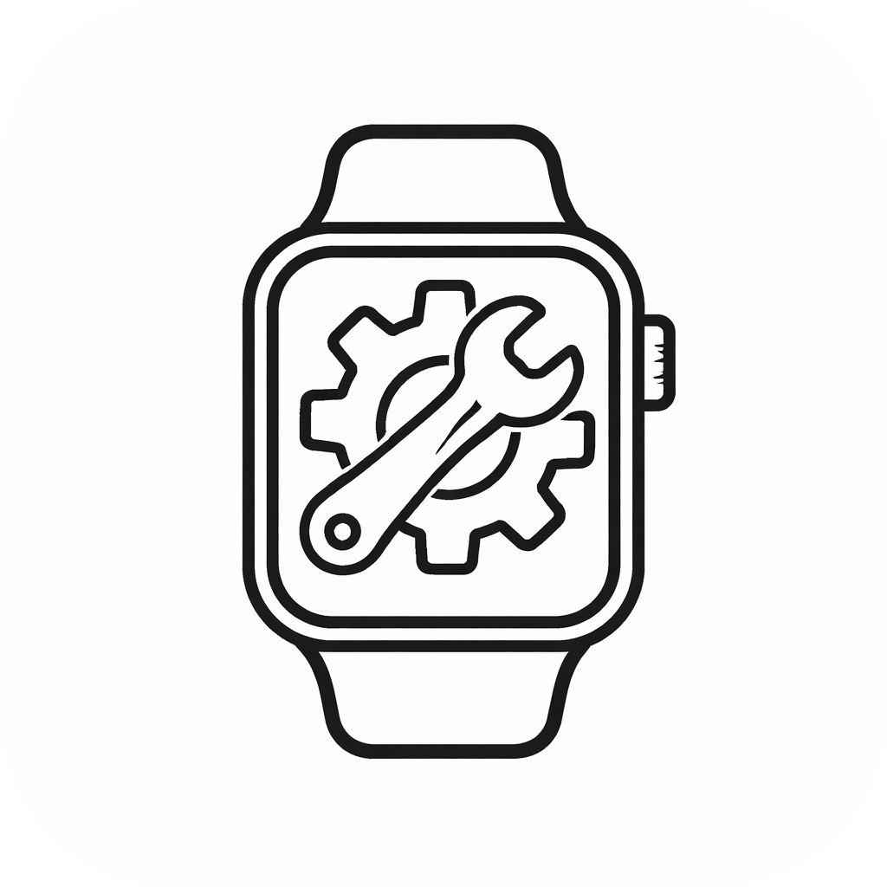

# watchifx-ios15.4fix

**Only support WatchOS 26 below**

## iOS 15.4 睡眠配置同步模块

本仓库包含 WatchFix 源码及正在整合的睡眠配置同步模块，入口为：

**WatchFix → 功能 → 睡眠配置同步 → 同步操作**。

不是独立 App，不增加首页独立入口。普通睡眠通知与蜂窝来电例外已获得一次研究性同步的用户验证；
App 内可重复手动同步的协调／恢复流程仍在开发验收，**目前执行禁用，不是可用发布版**。
微信实时来电在非睡眠状态也不提醒，作为独立通话传递问题，不以放行普通微信通知绕过。

模块代码与限制见 [`Modules/SleepSync/README.md`](Modules/SleepSync/README.md)。
临时身份、单次附加更新、真实 ACK 和恢复分别记录；ACK 不等于全部规则已经保存。
保留正常 AppsSupport／Messages 和 PairingCompatibility 行为，不伪造 ACK 或 initial-sync。

源码仓库不包含设备诊断、私人配置／例外、固件、SSH 凭据或研究构建产物。

The stability still needs to be tested

## Fix feature

- Fix Message auto uninstall
- Ping My Watch

### No test

- Fix Pairing
- System Update
- Cellular Support
- Lockdown Mode Support
- Watch Face Support
- Layout Support
- Photo Sync Support
- Media Sync Support
- Maps Support

## Unimplemented feature

- Health Support

## Tips

The other functions of the plugin are still not perfect at present. I am not familiar with iOS development, and I don't know how to deal with many problems. If anyone is willing to help with development, please contact me, and I can provide relevant materials.

## Sponsor

- [Patreon](https://patreon.com/577FKJ)
- [爱发电](https://afdian.com/a/577fkj)

## Build

### Requirements

- MacOS

### Step

1. Install [theos](https://github.com/roothide/theos)
2. Run `make package`

睡眠模块本机构建预览使用 `WATCHFIX_WITH_SLEEP_SYNC=1 make package`。
保持 `enabledForDevice=false`，不要手改开关绕过恢复验收。构建不等于安装授权，不运行 `make do`。

## Credits

- **[WatchPair11](https://github.com/plokijuter/WatchPair11)**: Multiple repair references
